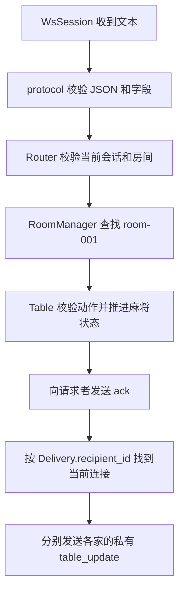

# 单房间服务端：实现与设计原因

本阶段把现有 WebSocket 协议接到 `Table`，支持四名临时玩家加入固定房间
`room-001`、准备、自动开局、请求自己的快照和提交动作。服务端入口现在使用
协议 v1；旧的无版本 `ping/echo` 测试协议已移除。

## 1. 请求如何进入牌桌



| 模块 | 做什么 | 为什么需要 |
| --- | --- | --- |
| `SessionManager` | 管理令牌、临时玩家和当前连接 | 同名玩家应独立；连接断开不意味着身份或座位消失 |
| `RoomManager` / `Room` | 持有固定牌桌、保存内部玩家 ID 到会话的索引 | 网络连接必须找到正确牌桌，牌桌返回的私有消息也必须找到正确接收人 |
| `Router` | 分派请求、检查认证和房间、发送回执与快照 | 将不可信网络输入与权威规则状态隔开，避免把业务堆进 `main()` |
| `Table` | 判断合法操作、去重、推进状态、过滤视角、保存牌谱 | 网络层沿用已经验证的麻将规则，不再另写一套状态机 |

代码位置：

- `backend/include/gymj/server/session/session_manager.hpp`
- `backend/src/server/session/session_manager.cpp`
- `backend/include/gymj/server/lobby/room_manager.hpp`
- `backend/src/server/lobby/room_manager.cpp`
- `backend/include/gymj/server/gateway/router.hpp`
- `backend/src/server/gateway/router.cpp`
- `backend/app/web_main.cpp`

## 2. 为什么身份不能来自客户端的座位号

`hello` 只创建临时身份，不占座位。服务端生成 32 字节随机令牌，编码为 64 个小写
十六进制字符；Windows 使用 `BCryptGenRandom`，Unix 使用 `/dev/urandom`，随机源
失败时不降级到伪随机数。昵称可以相同，递增的内部 `PlayerInfo.id` 也不作为登录凭据。

`join_room` 成功后，保存 `Table` 返回的 `assigned_player`，后续 `ready`、`snapshot`
和 `action` 都从这个绑定取得身份。客户端的 `roomId` 只用于一致性检查，额外传入
`seat` 或 `playerId` 会被协议层拒绝。否则玩家只要改一段 JSON 就能冒充其他座位。

重复入座复用已保存的 `PlayerInfo`，不再传入 `id = 0`，避免网络重试多占一个座位。
先保存绑定、再投递首次快照，保证刚入座者也能收到自己的状态。

## 3. 为什么回执与快照分开发送

`ack` 表示请求是否接受，`table_update` 表示牌桌现在是什么状态。一次出牌可能接着
触发响应、摸牌和结算，所以一次调用可能返回多份 `Delivery`。Router 先发送回执，
再按原顺序发送每份 Delivery，保留各自的 `view.table_seq`。

每份快照只发给其 `recipient_id` 对应的当前连接，编码器仅接收 Table 已脱敏的数据。
`snapshot` 请求也只回复本人。不能把某一家的完整快照广播给所有人。

`Table::submit` 继续负责请求编号和重复动作判定，Router 不提前按当前窗口拦截重试。
这样，原动作已经结束响应窗口甚至结算后，完全相同的请求仍可返回原回执，而不会再
出一次牌。失败请求也可能消耗编号，客户端新操作必须递增 `requestId`。

协议中的 `pass`、`ron`、`tsumo` 不携带 `tile`，而核心动作包含目标牌。因此 Table
从本人的当前合法动作中补齐执行副本的目标牌，同时保留原始 Command 用于回执缓存。
这既保留核心严格校验，也保证不带牌面的请求在窗口结束后仍能精确重试。

## 4. 开局与连接关闭的顺序

第四名玩家准备后，Room 检查四人是否全部入座、在线且准备；满足条件才调用
`Table::start()`。开始后 Table 会重置准备状态，重复准备不会覆盖进行中的牌局。

准备成功与自动开局失败分开报告：例如牌谱写入失败时，已经成功的准备回执仍是
`accepted: true`，另外发送 `start_failed` / `replay_write_failed` 通知。已接受的动作
也不会因为存储告警被改成失败，内部文件路径不会发给客户端。

为使协议中的令牌恢复可用，本阶段同时实现基本的连接替换：

1. 将同一会话绑定到新连接，再关闭旧连接。
2. 旧连接剩余消息不能再控制座位，旧关闭回调也不能把新连接标记离线。
3. 恢复时先发 `welcome`，再通过原身份入座并发送快照；请求水位和操作期限不重置。
4. 若旧连接仍在写快照，等待当前写操作完成后发送关闭帧。

`send_text` 队列溢出可能同步触发关闭回调，因此 `main()` 用 `asio::post` 延后处理
断线。否则断线会重入业务层，把较新的断线快照插入较旧的出牌快照之间。

## 5. 本地构建与验证

在仓库根目录运行：

```powershell
cmake -S backend -B build-web-vendored -G "Visual Studio 17 2022" -A x64
cmake --build build-web-vendored --config Debug --parallel 4
ctest --test-dir build-web-vendored -C Debug --output-on-failure
```

CMake 检测到 Node.js 22+ 时自动注册四组真实 WebSocket 测试，不需要安装 npm 包。
没有合适的 Node 时，配置输出会说明跳过网络测试，C++ 测试仍可运行。

- `gymj_session_manager_tests`：同名身份隔离、令牌形状、重复认证、当前连接归属、
  旧关闭回调迟到和离线身份恢复。
- `gymj_table_tests`：增加不带牌面的过、荣和、自摸，以及窗口结束后的精确重试。
- `gymj_web_transport_tests`：v1 ping、坏输入、二进制消息、发送顺序和超大消息隔离。
- `gymj_web_game_tests`：四人入座准备、第五人满房、私有快照、合法出牌、重复与过期
  请求、伪造身份字段、在线接管、离线恢复，并持续操作到流局，检查结算和牌谱。
- `gymj_web_timeout_tests`：真实定时器驱动的离线自动出牌、重连不续时、迟到请求去重，
  以及全程无人操作的自动过牌、流局结算、私有快照和牌谱连续性；空闲和结算后不重复广播或落盘。

也可直接运行：

```powershell
node scripts/test-game.mjs build-web-vendored/app/Debug/gymj_server.exe
node scripts/test-timeout.mjs build-web-vendored/app/Debug/gymj_server.exe
```

网络脚本使用系统临时目录中的独立工作目录，退出后只清理自己创建的目录。

手动调试：运行 `build-web-vendored/app/Debug/gymj_server.exe`，打开
`frontend/public/network-test.html`。四个独立标签页分别连接并发送 `hello`，点击
“加入 room-001”和“准备”，第四人准备后即可查看各自快照。发送动作时从本人最新
快照复制 `roundId`、`promptId` 和一个 `availableActions`，使用新的 `requestId`。
通信记录会隐藏令牌，当前标签页可用“恢复当前身份”发送已保存的凭据。

## 6. 超时调度

`Router` 持有 Asio `steady_timer`，启动后每 25 毫秒调用一次固定房间的 `Table::tick()`。
计时器、消息和断线回调都在同一个 `io_context` 线程执行，牌桌状态不会被并发修改。
截止时间仍由 Table 的单调时钟判定；调度间隔及事件循环负载可能使代打略晚于截止时间，
但不会提前代打。一次 tick 不会把刚产生的新操作窗口也立即判为超时。

超时沿用核心策略：响应窗口自动过牌，摸牌后自动摸切，碰后打出手牌末张。
无人操作或断线时仍推进到流局和计分，重连不会延长期限。计时结果通过原有 `deliver()`
逐人发送私有快照，保持序号顺序；空闲 tick 不广播快照或重复发送旧的存储告警。
退出信号会停止调度并取消计时器，回调使用弱引用避免保持 Router 存活。

默认操作期限保持 8000 毫秒，可在启动时调整：

```powershell
build-web-vendored/app/Debug/gymj_server.exe 8080 --action-timeout-ms 15000
```

参数 `--seed N` 固定牌桌随机种子，供本地复现和自动化测试使用；每局再由牌桌随机序列
派生自己的洗牌种子。常规运行省略此参数。超时测试使用 1500 毫秒检查重连，使用
100 毫秒完成整局无人操作验收，无需等待默认期限下的完整牌局。

## 7. 本阶段边界

目前固定一个房间、四个座位，关闭网页保留原座位；身份保存在内存中，服务重启后失效。
已支持等待准备或结算后的主动离桌和座位释放。动态建房、房间回收和会话过期尚未实现。Vue 牌桌已接入协议 v1，连接与联调步骤见
[前端说明](../frontend/README.md)。

超时托管只负责推进当前小局；结束后仍需四名在线玩家重新准备才能开始下一局。

## 8. 主动离桌

`leave_room` 经 Router 验证当前身份和房间后交给 `Room::leave()`，再由 `Table::leave()`
检查阶段并释放座位。对局中拒绝离桌，关闭网页仍是断线，保留座位和托管。

成功后 Room 删除投递索引及会话中的房间、玩家绑定；认证令牌继续有效。离桌者收到成功
回执，剩余在线玩家收到空座位快照。未入座时重复离桌不修改牌桌，离桌者的旧连接关闭也
不能影响新占座者。新入座分配新的内部玩家 ID。

离桌者累计分清零，其他玩家累计分保留。全员准备取消，上一局状态移除，牌桌返回等待准备，
避免新名字对应旧手牌或结算。已完成牌谱不改写；局号、桌序号以及牌谱文件继续沿用。
四人都离桌后，固定房间保留为空桌，可直接重新加入；本阶段不实现自动踢出或房间销毁。

`gymj_web_leave_tests` 覆盖认证与伪造字段、重复离桌、空座位广播、第五人补位、旧身份访问
拒绝、离桌后恢复未入座身份、对局中拒绝离桌和空桌再次开局。可单独运行：

```powershell
node scripts/test-leave.mjs build-web-vendored/app/Debug/gymj_server.exe
```
